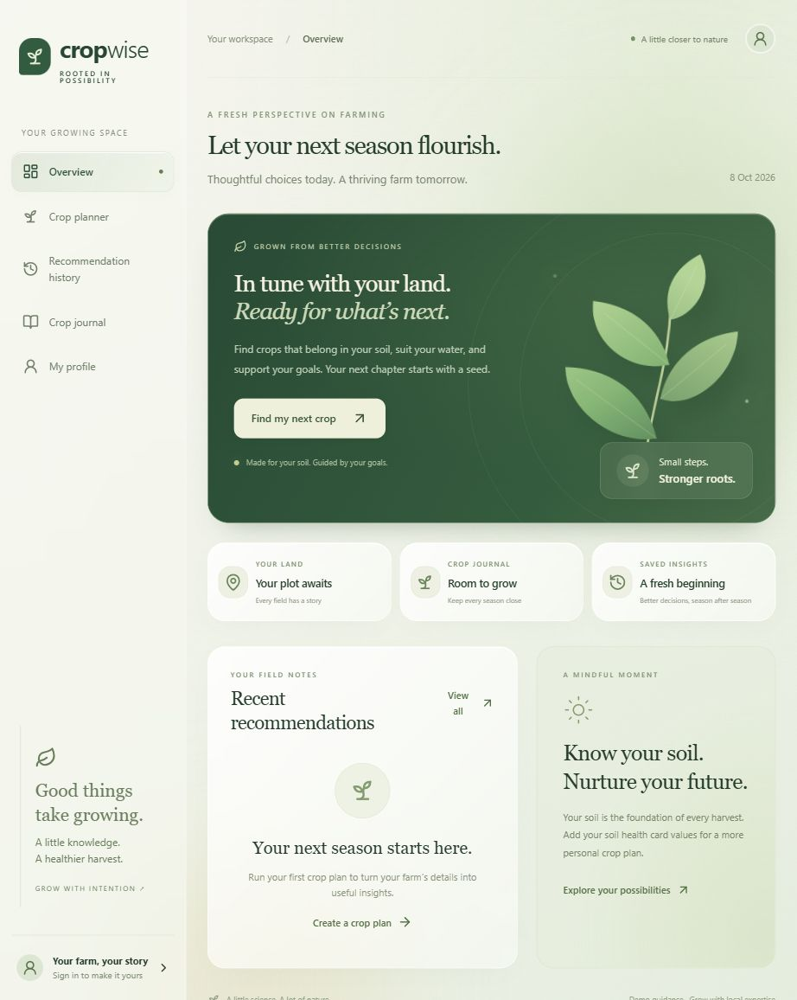

# Crop Decision AI — CropWise 🌾

A full-stack, risk-aware agricultural decision-support and crop health platform combining Machine Learning with real-world agronomic models.



---

## Architecture & File Structure

The project is structured as a clean full-stack monorepo with clear separation between the Python FastAPI backend, the React + Vite frontend, and deployment configurations:

```
AI_BCR/
├── api/                             # Serverless deployment entrypoint
│   └── index.py                     # Vercel serverless FastAPI handler
│
├── backend/                         # FastAPI Application & ML Services
│   ├── app/
│   │   ├── api/                     # REST API route controllers
│   │   │   ├── accounts.py          # Google Auth, farm profile, & crop journal routes
│   │   │   ├── crop_health.py       # Vision diagnostics & crop lifecycle roadmap API
│   │   │   ├── crops.py             # Supported crop taxonomy & list endpoint
│   │   │   ├── realtime.py          # Live Open-Meteo weather, soil & mandi market prices
│   │   │   └── recommendations.py   # Hybrid ML crop recommendation endpoints
│   │   ├── services/                # Core business logic & model engines
│   │   │   ├── crop_health.py       # Image leaf diagnosis, disease symptoms & remedies
│   │   │   ├── realtime.py          # Real-time satellite weather, topsoil moisture & pricing
│   │   │   └── recommendation.py    # Random Forest ML model + agronomic scoring logic
│   │   ├── accounts.py              # SQLite account database & Google auth verification
│   │   ├── main.py                  # FastAPI application setup, CORS & middleware
│   │   └── schemas.py               # Pydantic request/response data contracts
│   ├── tests/                       # Automated test suite
│   │   ├── test_accounts.py         # Auth & persistence tests
│   │   └── test_recommendation_and_realtime.py # ML & realtime endpoint tests
│   ├── .env.example                 # Environment configuration template
│   └── requirements.txt             # Backend Python dependencies
│
├── frontend/                        # Modern React Single Page Application
│   ├── public/
│   │   └── assets/                  # Soil reference imagery (black, clay, red, sandy)
│   ├── src/
│   │   ├── components/              # Modular UI components
│   │   │   ├── CropHealthView.jsx   # AI leaf diagnosis, timeline tracker & cycle roadmap
│   │   │   ├── PictureCard.jsx      # Accessible visual selection cards
│   │   │   ├── ProgressBar.jsx      # Wizard progress & mode toggle
│   │   │   ├── ScoreCounter.jsx     # Animated suitability percentage counter
│   │   │   ├── SeedlingLoader.jsx   # Animated botanical loading indicator
│   │   │   └── WizardStep.jsx       # Wizard step transition wrapper
│   │   ├── App.jsx                  # 5-step Farmer Wizard & ResultCard component
│   │   ├── FarmApp.jsx              # Main dashboard shell (Overview, Planner, Health, etc.)
│   │   ├── api.js                   # Unified fetch client with CSRF and error handling
│   │   ├── cropHealthI18n.js        # Multilingual strings (en, te, hi, kn, ta, mr)
│   │   ├── i18n.js                  # Internationalisation dictionary for planner
│   │   ├── index.css                # Curated nature design system, tokens & dark mode
│   │   ├── main.jsx                 # React root mount
│   │   ├── mappings.js              # Agronomic lookup tables & payload builder
│   │   └── utils.js                 # Geolocation, Open-Meteo client, TTS speech helpers
│   ├── package.json                 # Frontend scripts & dependencies
│   ├── tailwind.config.js           # Tailwind theme extension tokens
│   └── vite.config.js               # Vite build & local API proxy configuration
│
├── docs/                            # Documentation assets & screenshots
│   └── cropwise-preview.jpg         # Application overview screenshot
│
├── package.json                     # Root npm script runner (`npm run build`, `npm run dev`)
├── requirements.txt                 # Root Python dependencies for cloud deployments
├── pytest.ini                       # Test configuration for root pytest execution
├── vercel.json                      # Full-stack production deployment configuration
├── .gitignore                       # Git exclusion rules
└── README.md                        # Documentation & setup guide
```

---

## Tech Stack
- **Frontend**: React 19 + Vite 6 + Vanilla CSS / Tailwind CSS + Framer Motion + Lucide Icons
- **Backend**: FastAPI + Pydantic v2 + Uvicorn
- **Machine Learning**: scikit-learn (Random Forest baseline trained on 2,200 Kaggle agricultural records)
- **Agronomic Logic**: Hybrid ML probability + nutrient balance, seasonal constraints, water availability & soil pH penalties
- **AI Vision Diagnostics**: Crop health image analysis with disease symptom detection, recovery timeline, and organic/chemical remedy roadmaps
- **Real-Time Data**: Live Open-Meteo satellite weather (temp, humidity, rain) + topsoil moisture (0-10cm) + mandi commodity prices

---

## Quickstart

### 1. Run Backend

```bash
cd backend
python -m venv .venv

# Windows:
.venv\Scripts\activate
# macOS/Linux:
source .venv/bin/activate

pip install -r requirements.txt
uvicorn app.main:app --reload --port 8000
```

- API Docs: `http://localhost:8000/docs`

### 2. Run Frontend

```bash
cd frontend
npm install
npm run dev
```

- Web App: `http://localhost:5173`
- The Vite dev server automatically proxies `/api` calls to `http://localhost:8000`.

### 3. Run Automated Tests

Run backend tests from repository root:
```bash
pytest
```

Run frontend test suite:
```bash
npm --prefix frontend test
```

---

## Key Features

### 1. Farmer-Friendly 5-Step Wizard Flow
Designed specifically for smallholder farmers with picture cards, regional language localization, and voice narration:
- **Step 0: Language Selection** — English, Telugu (తెలుగు), Hindi (हिन्दी)
- **Step 1: Location & Season** — GPS auto-detect or place name search; automatically fetches live weather and infers Kharif/Rabi/Zaid season
- **Step 2: Soil Profile** — Soil Health Card lab values (N, P, K, pH) or intuitive visual cards (soil color + growth quality)
- **Step 3: Water & Acreage** — Rainfed, canal, borewell, or drip irrigation with farm area slider
- **Step 4: Crop Rotation** — Previous crop history to avoid monoculture depletion
- **Step 5: Farming Objective** — Maximum profit, low risk, water conservation, or balanced output

### 2. Crop Health & Disease Diagnostics
- **Leaf & Canopy Analysis**: Upload a picture from phone camera or test with pre-loaded presets (Tomato Early Blight, Corn Rust, Cotton Leaf Curl, Rice Blast)
- **Health Indicators**: Canopy greenness score, chlorosis (yellowing), necrosis (lesions), and immediate treatment urgency
- **Curative Roadmaps**: Chemical fungicides/antibiotics alongside residue-free organic/biological controls
- **Overtime Timeline**: Track crop health progress across successive field scans
- **Multilingual Support**: Available in English, Telugu, Hindi, Kannada, Tamil, and Marathi

### 3. Google Sign-In & Crop Journal
- Save and review recommendation histories across seasons
- Log planted crops with acreage, planting date, and stage (Planned, Growing, Harvested)
- SQLite database persistence with HttpOnly cookie sessions
